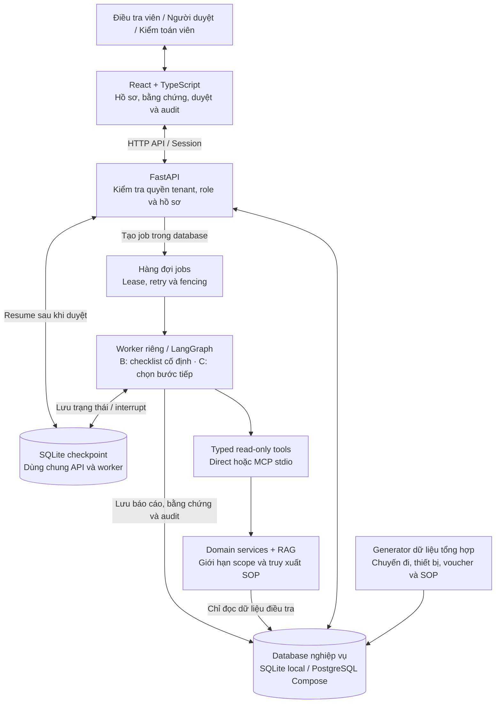
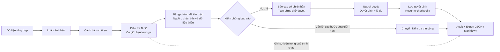

# TraceLens — Fraud Investigation Copilot

An evidence-first investigation sandbox for synthetic ride-hailing voucher alerts.
Trace the evidence. Test the hypothesis. Human reviewers make the disposition.

TraceLens giúp điều tra viên xem chuyến đi, thiết bị, sổ voucher và SOP trong cùng một hồ sơ.
Cảnh báo upstream là tín hiệu cần kiểm tra; đề xuất của workflow không phải kết luận gian lận.
Ứng dụng độc lập, không liên kết doanh nghiệp và không tác động tài khoản hay thanh toán thật.

## Sơ đồ dự án

### Kiến trúc tổng quan



Database nghiệp vụ lưu cả nguồn, hồ sơ, jobs và kết quả. Checkpoint là kho SQLite riêng;
PostgreSQL trong sơ đồ là cấu hình Compose, chưa được kiểm chứng runtime.
Mặc định dùng mock và lexical retrieval, không cần API key.

### Luồng từ dữ liệu đến quyết định



Thiếu nguồn hoặc chưa thu thập đủ bằng chứng có thể tạo báo cáo `INSUFFICIENT_EVIDENCE` để người duyệt xử lý.
Quyết định gắn với version/hash/snapshot; nếu resume lỗi, trạng thái `review_pending_resume`
giữ quyết định đã lưu để worker thử lại. Audit được ghi xuyên suốt luồng, không chỉ ở bước cuối.
Chi tiết ranh giới quyền và state machine: [ARCHITECTURE](docs/ARCHITECTURE.md).

## Chạy local trên Windows

Cần Python **3.12**, Node **24**, `uv`. Chạy từ gốc repository:

```powershell
uv sync --frozen
Copy-Item .env.example .env
uv run --frozen alembic upgrade head
uv run --frozen python -m data.generator.seed --seed 42 --split demo
npm.cmd --prefix apps/web ci
npm.cmd --prefix apps/web run build
uv run --frozen uvicorn apps.api.main:app --host 127.0.0.1 --port 8000
```

Mở terminal thứ hai, cùng thư mục và `.env`:

```powershell
uv run --frozen python -m apps.worker.main
```

Mở **http://127.0.0.1:8000**. Trên Linux/macOS dùng `cp .env.example .env` và `npm` thay `npm.cmd`.
API phục vụ bản React đã build; không mở trực tiếp `apps/web/index.html` bằng `file://`.
Khi sửa UI, chạy `npm.cmd --prefix apps/web run dev`; Vite proxy `/api` tới cổng 8000.

| Tài khoản local | Quyền |
| --- | --- |
| `investigator` | Xem nguồn, tạo lượt điều tra B/C |
| `reviewer` | Xem bằng chứng và ghi quyết định đúng phiên bản |
| `auditor` | Đọc hồ sơ, audit và export |
| `other-investigator` | Tenant B, không đọc được hồ sơ tenant A |

Mật khẩu demo mặc định: `tracelens-local`. `DEMO_PASSWORD` áp dụng khi seed tài khoản mới;
seed lại không đổi mật khẩu hoặc xóa lịch sử. Session HTTPOnly, role/tenant lấy từ database.
Cookie `Secure=false` chỉ phục vụ HTTP local; đây không phải cấu hình để public server.

## Demo hai hồ sơ

1. Đăng nhập `investigator`, xem `TL-1041` và `TL-1042`: cùng cảnh báo 3 tài khoản / 6 redemption.
2. Mở baseline A để xem đầy đủ timeline, sổ voucher, nguồn và mẫu ghi chép không dùng LLM.
3. Chạy C: `TL-1041` có khoảng thiết bị chồng lấn, 120.000₫ ưu đãi ròng;
   `TL-1042` dùng kế tiếp, lịch sử tài khoản lâu hơn, còn 40.000₫ sau reversal.
4. Nhấp bằng chứng rồi mở bản ghi nguồn. Đăng nhập `reviewer`, nhập lý do và ghi disposition sandbox.
5. Xem audit, tải JSON/Markdown. Điều tra lại tạo phiên bản mới và giữ lịch sử cũ.

Thời gian nguồn lưu UTC; UI hiển thị `Asia/Ho_Chi_Minh`. Tiền được tính bằng integer VND.
Nguồn lỗi, chưa thu thập hoặc hết budget dẫn tới `INSUFFICIENT_EVIDENCE`/kiểm tra thủ công.

## Thành phần đã có

- FastAPI/Pydantic, SQLAlchemy/Alembic; SQLite local và cấu hình PostgreSQL Compose.
- Generator có seed, 12 hồ sơ demo tenant A + 1 tenant B, dữ liệu hoàn toàn tổng hợp.
- Worker riêng với DB queue, lease/fencing/retry; LangGraph checkpoint và human interrupt/resume.
- 7 typed read-only tools, backend kiểm tra scope; MCP stdio dùng chung domain services.
- SOP có phiên bản/hiệu lực/ACL, lexical BM25; adapter hybrid cần embedding thật.
- Báo cáo giữ nguồn đã thu thập, số liệu có kiểm chứng, phản bác và dữ liệu thiếu.
- Duyệt gắn version/hash/snapshot, chống gửi trùng và bản cũ; export và audit.

Mode B có checklist cố định; mock C dùng heuristic và kết quả quan sát để chọn bước tiếp.
Live adapter hiện hỗ trợ planner JSON và tóm tắt; recommendation/claims vẫn do template tạo.
Đây chưa phải triển khai LLM tự tổng hợp toàn bộ báo cáo như mục tiêu MVP đầy đủ.

## Mock / live và credential

Mặc định `.env`: `LLM_MODE=mock`, `RETRIEVAL_MODE=lexical`, không cần API key.
Không đưa key vào frontend, Git hoặc báo cáo. Live/hybrid chưa được chạy với dịch vụ thật trong phiên review.

Muốn smoke test live, tự điền `LLM_MODE=live`, `LLM_API_KEY`, `LLM_MODEL`, `LLM_BASE_URL`
trong `.env`, giữ `RETRIEVAL_MODE=lexical`, rồi chạy:

```powershell
uv run --frozen python -m apps.worker.main --case TL-1041 --mode B
```

Backend dùng API tương thích `/chat/completions`, JSON-object output. Kiểm tra khả năng hỗ trợ của provider/model.
Không có key sẽ fail rõ ràng, không tự coi mock là live. Embedding có cấu hình độc lập;
hybrid có thể phát sinh gọi mạng khi xem dữ liệu. Chỉ bật khi chủ động cấu hình.
Token được lấy từ provider hoặc gắn nhãn `estimated`; chi phí để unknown nếu chưa có cấu hình giá.

## Kiểm thử

```powershell
uv run --frozen pytest -q
uv run --frozen ruff check apps data evaluation migrations tests scripts
npm.cmd --prefix apps/web run build
npm.cmd --prefix apps/web exec -- playwright install chromium
npm.cmd --prefix apps/web run test:e2e
uv run --frozen python -m apps.mcp.smoke_test
```

E2E tự khởi động API + worker tại `127.0.0.1:8011`, migrate/seed database riêng dưới `.cache/e2e/`.
Không dùng lại hoặc reset database demo. Nếu đặt `E2E_BASE_URL`, hãy trỏ tới môi trường test riêng.
Kết quả kiểm chứng cập nhật tại [IMPLEMENTATION_STATUS](docs/IMPLEMENTATION_STATUS.md).

## Docker Compose

```powershell
docker compose up --build
```

API/UI ở `127.0.0.1:8000`, worker riêng, PostgreSQL không publish port ra host.
Migration/seed chờ DB healthcheck; không tự reset. Gold, `.env`, database local và `node_modules`
được loại khỏi build context. Checkpoint hiện dùng SQLite trên volume chung API/worker.
**Docker build/run và PostgreSQL integration chưa được kiểm chứng khi daemon chưa chạy.**
Đường local SQLite phía trên là đường đã dùng để kiểm thử.

## Dữ liệu & evaluation

```powershell
uv run --frozen python -m data.generator.seed --split dev --seed 101 --count 50 --no-background
uv run --frozen python -m data.generator.seed --split heldout --seed 202 --count 150 --no-background
uv run --frozen python -m evaluation.runners.run_benchmark --split dev --seed 101 --limit 6
```

Lệnh seed split thêm dữ liệu vào DB đang cấu hình. Runner benchmark tự tạo DB, checkpoint và gold
riêng trong `.cache/benchmarks/<experiment>/`; không thay đổi database demo hoặc gold đã commit.
Artifact lưu cả output và lỗi, mode thực, mẫu số và provenance. Provider CLI phải khớp `LLM_MODE`;
live batch cần `--allow-paid-live` và `--limit`, không cho degraded fallback.

**Mock benchmark chỉ kiểm tra plumbing/template.** A là mẫu chưa có người điền;
dev/heldout cùng họ kịch bản và nhãn theo quy tắc. Không suy ra C tốt hơn điều tra viên,
năng lực reasoning, fraud accuracy hay ROI từ các điểm số này. Xem [EVALUATION](docs/EVALUATION.md).

Reset demo chỉ khi chủ động muốn xóa dữ liệu trong `DATABASE_URL`:

```powershell
uv run --frozen python -m data.generator.seed --reset-demo-db --confirm-reset --split demo
```

## Tài liệu và giới hạn

[Architecture](docs/ARCHITECTURE.md) · [Threat model](docs/THREAT_MODEL.md) ·
[Demo script](docs/DEMO_SCRIPT.md) · [Runbook](docs/RUNBOOK.md) ·
[Review trước publish](docs/RELEASE_REVIEW.md).

Audit append-only ở application layer, không tamper-proof; nguồn synthetic có snapshot ID nhưng
chưa có kho version bất biến để chống DBA sửa trực tiếp. Timeout/tool size chưa là hard resource
isolation cho mọi truy vấn. Chưa đánh giá live LLM, hybrid embeddings, human study hoặc môi trường doanh nghiệp.
Không dùng các kết quả này làm cơ sở tự động xử lý người dùng thật.
