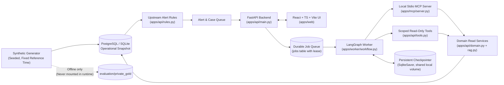
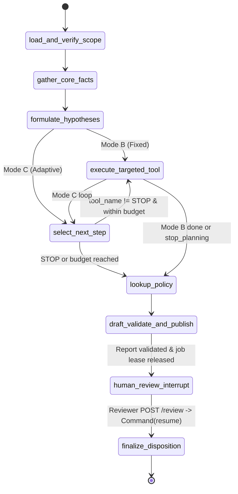

# Kiến trúc hệ thống (Architecture) — TraceLens

## 1. Sơ đồ thành phần và luồng dữ liệu

Luồng nghiệp vụ chuẩn:
`Synthetic data -> rules -> alert/case -> durable job -> gather facts -> hypotheses -> targeted checks -> policy lookup -> draft -> validation (+ bounded repair) -> human review (interrupt) -> disposition + audit`.

## 2. Ranh giới tin cậy (Trust Boundaries)

1. **Browser / UI <-> FastAPI API (`apps/api/main.py`, `apps/api/security.py`):**
   - Xác thực bằng HTTPOnly session cookie (`tracelens_session`, `SameSite=Strict`), kiểm tra `Origin`, `Sec-Fetch-Site` và header `X-CSRF-Token` cho mọi request thay đổi trạng thái.
   - `actor_id`, `role` và `tenant_id` luôn lấy từ phiên đăng nhập trên server (`LoginSession` -> `User`), không bao giờ nhận từ body hay query string.
   - Mọi DTO đầu vào dùng `ConfigDict(extra="forbid")`.
2. **API / Worker <-> Read-Only Domain & Database (`apps/api/domain.py`):**
   - Toàn bộ truy vấn dữ liệu điều tra chạy trong `readonly_session(engine)`: bật `PRAGMA query_only=ON` (SQLite) hoặc `SET TRANSACTION READ ONLY` (PostgreSQL).
   - Mọi bản ghi (`Rider`, `Driver`, `Device`, `DeviceUsage`, `SessionEvent`, `Trip`, `LedgerEntry`, `SourceQuality`) đều bị ràng buộc bởi bộ ba `(tenant_id, case_id, snapshot_id)` và mốc thời gian `<= case.cutoff`.
3. **Worker <-> Tool / MCP Adapter (`apps/api/tools.py`, `apps/mcp/`):**
   - Chỉ cho phép 7 tool trong `READONLY_TOOL_ALLOWLIST`.
   - Khi gọi qua MCP (`stdio`), worker ký `TrustedContext` bằng HMAC-SHA256 (`issue_scope_token`). MCP server xác thực chữ ký và kiểm tra lại trạng thái `User.active`, `tenant_id`, `case_id`, `snapshot_id` trong DB trước khi đọc dữ liệu. Model không thể truyền `tenant_id` hay `case_id` khác để mở rộng phạm vi.
4. **Runtime <-> Evaluation Gold Store (`evaluation/private_gold/`):**
   - Không có bất kỳ trường `is_fraud` hay tên kịch bản nào trong cơ sở dữ liệu runtime.
   - Các container `api` và `worker` trong `compose.yaml` không mount thư mục `evaluation/private_gold`.

## 3. Máy trạng thái LangGraph (`apps/worker/workflow.py`)

- **Tạm dừng bền vững (`interrupt`):** Trước khi gọi `interrupt()`, node `draft_validate_and_publish` đã lưu `Evidence`, `Report`, ghi `AuditEvent` và giải phóng lease của `Job` (`status="done"`). Nhờ vậy, hồ sơ chờ người duyệt không giữ kết nối giao dịch DB hay khóa worker.
- **Tính bất biến khi chạy lại (Idempotency):** Khi resume từ `human_review_interrupt`, LangGraph chạy lại node chứa `interrupt`. Nhờ kiểm tra `existing_report` theo `run_id` và `ReviewDecision` theo `(actor_id, idempotency_key)` + `UniqueConstraint("report_id")`, hệ thống không bao giờ nhân bản báo cáo hay quyết định duyệt.

